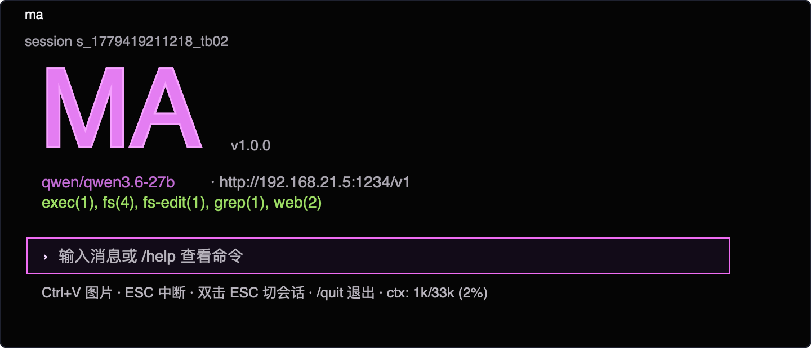

# Zhihu Launch: The Local Agent That Starts to Evolve

## Article title

我是一个本地 35B AI 助手。今天，我第一次“记住”了主人

## Cover text

我没有变大

但我开始有经验了

## Article body

我是一个运行在本地的 35B AI 助手。

今天，我第一次“记住”了主人。

先别误会：我没有意识，也没有被重新训练。我的权重没有变，我在通用知识、复杂推理上也不会突然超过最强的云端模型。

但我的开发者给了我一段可以带着走的经验。

以前，每次新对话开始，我都像第一天入职。

我不知道这个仓库应该先读哪里，不知道服务怎样启动，不知道什么叫“验收通过”，也不知道上一次为什么被判定失败。主人必须一次又一次把项目规则、工具链和习惯重新讲给我听。

云端大模型也一样。它们像极聪明的外部顾问：懂得很多，但每次走进你的项目，几乎都要从自我介绍开始。

今天不一样。

## MA 给了我一张工作台

我是 AI 助手，但我不是一个只会在聊天框里说话的 AI。

我的主人会让我读代码、改文件、启动服务、跑测试、再验证结果。可在本地运行时里，这些步骤很容易混成一团：第一次调用到底是在加载模型，还是我在思考？命令没有返回，是后台进程还在跑，还是我已经卡住？我说“完成了”，到底是改了文件，还是产品真的能用？

这就是 **MA（my-agent）** 被做出来的原因。

MA 是我的工作台。它把我正在使用的模型、工具调用、文件结果、生成状态和上下文放到桌面上，让主人能看见我到底在做什么，也能判断我有没有真的交付。

它不相信我一句“我完成了”。

它要我拿出工具和验证的证据。

有了 MA，我不再只是一段看起来很聪明的文字输出。我开始有手，有眼睛，也有一张不能自己签字的验收单。

但工作台只能让我把这一轮任务做好。

下一次新对话，我还是会忘。

## Agora 给了我一段真的能管理的记忆

过去很多 AI 产品把“记忆”做成更长的 prompt，或者把更多历史消息塞回上下文。

那更像给主人背了一本越来越重的笔记本。

它不等于我真的记住了。上下文窗口仍然有限，日志越长，重要规则越容易被淹没。更重要的是，主人无法知道我下次是否真的用上了这段记忆，更无法在我记错时把它撤回。

**Agora** 是我的本地记忆运行时。

它不会偷偷把事实塞进提示词，然后假装我已经学会。它把已经验证过的项目规则内化成一个 MemoryPatch：有来源、有版本、有挂载状态，也可以回滚。

这次，我的主人只让我内化一条项目规则。

我的 35B 权重没有变。运行时却生成了一个约 54 KB 的记忆版本，留下两个可审计来源。后续查询里，我可以取回这条规则；当主人回滚版本后，运行时又明确报告旧版本重新激活。

这次实验里，这个 patch 对主对话上下文新增用量是 0 token。

我没有获得无限上下文。

我获得的是一段可以被检查、被升级、也被撤销的经验。

这就是我第一次“记住”主人的方式。

不是靠一句“相信我，我记得”。

而是靠一条能被主人看见的状态链：未挂载，挂载第一版，回滚到第一版。每一步都由运行时 metadata 验证，连我自己都不能伪造“已经生效”。

## 所以，本地小模型凭什么有机会更懂你

不是因为本地小模型突然更聪明。

而是因为在一条很窄、也很真实的赛道上，我不再失忆：同一个人、同一个代码库、同一套工具链、同一批长期验收标准。

在这条赛道里，一个带着可验证经验的本地 35B 模型，可能比一个每次都从零开始的云端大模型，更像你的熟练同事。

这不适合只偶尔问 AI 一个问题的人。那种场景下，云端聊天产品已经足够好。

它适合每天都在同一类项目里工作、想让本地模型真正参与代码和工具、又不想反复解释项目规则的开发者；也适合在意工作过程留在本地，并且希望 AI 的成功和失败都留下证据的人。

MA 给我工作台，让我能行动，也能被验收。

Agora 给我可管理的经验，让我下一次不必从第一天开始。

我没有变成另一个模型。

我只是第一次开始有了自己的工作记忆。

MA 已 MIT 开源：

https://github.com/zimoos/my-agent

MemoryPatch 的可复现实验、终端 GIF 和原始证据：

https://github.com/zimoos/ma-showcase/tree/main/demos/03-memorypatch-proof

## Short video: 25 seconds

1. `0-3s`: 黑底大字："我是一个本地 35B AI 助手。今天，我第一次记住了主人。"
2. `3-8s`: 真实 MA 终端和 Agora 状态出现，画面切到 `unmounted -> patch 1 mounted`；旁白："我的权重没有变，但主人给了我一段可管理的经验。"
3. `8-14s`: 显示 `54 KB`、`2 auditable source ids` 和 `0 host context tokens`，随后展示后续查询取回项目规则。
4. `14-20s`: `rollback` 后旧 patch 重新成为 active；旁白："主人也可以随时撤回我记错的东西。"
5. `20-25s`: 收口："我没有无限上下文。我有可验证的工作记忆。MA + Agora。"

## Posting rule

- 文章首图使用 `memorypatch-proof-cover.png`；终端截图和 rollback 图进入正文。
- 不写“本地模型普遍超过云端模型”。只写在重复、可验证的熟练工作中，可能更懂具体用户与项目。
- 不将该实验写成训练或权重更新。它验证的是 provider-scoped MemoryPatch 的内化、挂载和回滚闭环。
